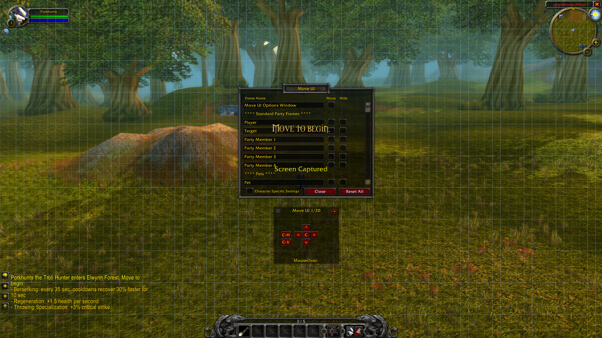

# Move UI

**A lightweight UI mover for Azeroth Survivors.**

Move UI adapts and modernizes the classic MoveAnything interface for Azeroth Survivors. The goal is to make repositioning the game's existing interface simple and reliable while removing legacy World of Warcraft features that the game does not use.



## Project Status

Move UI 1.2.9 adds a unified minimap launcher and an Add-on Tools panel for optional BigCursor and LocalClock integrations. The established mover, saved-position, grid, run timer, and LocalClock frame behavior are preserved.

For version history, see [CHANGELOG.md](CHANGELOG.md).

## Features

- **Frame positioning:** Move supported interface frames using on-screen controls.
- **Frame visibility:** Hide supported frames where applicable.
- **Reset controls:** Reset individual frames or reset supported frame positions.
- **Alignment grid:** Display a full-screen grid to help position interface elements accurately.
- **FPS display:** Keep the FPS display available for monitoring performance.
- **Minimap launcher:** A draggable, position-saving Move UI bubble for round and square minimaps.
- **Add-on Tools:** Open BigCursor controls and LocalClock Options/Clock Tools from one place; the standalone addon bubbles are hidden only while Move UI is active.
- **Simplified interface:** Remove obsolete menu entries for systems that Azeroth Survivors does not use.
- **Move complete UI assemblies:** Prefer moving an entire interface assembly instead of exposing its individual buttons as separate movers.

## Design Goals

Move UI is designed specifically around Azeroth Survivors rather than attempting to reproduce every feature of the original World of Warcraft addon.

Our priorities are:

- Preserve the game's existing UI layout and the relationships between its components.
- Make moving interface elements straightforward without unnecessarily exposing individual buttons and subcomponents.
- Remove obsolete or unsupported WoW-specific options.
- Keep useful functionality while introducing game-specific improvements where appropriate.
- Maintain compatibility with the game's actual UI API and frame behavior.

## Installation

1. Download or clone this repository.
2. Locate the `MoveUI` addon folder.
3. Copy the `MoveUI` folder into Azeroth Survivors' `Interface/AddOns` directory.
4. Confirm that `MoveUI.toc` is directly inside the `MoveUI` folder.
5. Launch the game and enter `/move` to open the Move UI options window.

The final directory structure should look like this:

```text
Interface/
└── AddOns/
    └── MoveUI/
        ├── MoveUI.toc
        ├── MoveAnything.xml
        ├── MoveAnything.lua
        ├── MoveUIFrameCatalog.lua
        ├── MoveUIRunClock.lua
        ├── MAPredefinedFrames.lua
        ├── MoveUIFrameRegistry.lua
        ├── MoveUIMover.lua
        ├── MoveUIVisibility.lua
        ├── MoveUICompatibilityHooks.lua
        ├── MoveUICommands.lua
        ├── MoveAnythingGrid.lua
        ├── MoveUIAddonTools.lua
        ├── MoveUIMinimapButton.lua
        └── MoveUIAddonIntegration.lua
```

## Known Issues

Move UI is still being adapted to Azeroth Survivors' interface. Current areas for improvement include:

- **Frame layering:** Some character and enemy frames can appear underneath the alignment grid.
- **Toolbar alignment:** Reset positions and default toolbar geometry need further verification against Azeroth Survivors' original UI.
- **Frame compatibility:** Some legacy frame entries may require additional auditing.

These issues are being tracked as development continues.

## Development

Move UI is being developed incrementally, with changes tested against the actual game wherever possible. Add-on shortcuts remain optional: Move UI detects BigCursor and LocalClock through their slash-command registrations and does not require either addon to be installed.

Legacy internal identifiers may be retained when changing them could break compatibility. User-facing labels, obsolete menu entries, and documentation are cleaned up separately to reduce unnecessary risk.

Bug reports are most useful when they include:

- The frame or feature involved.
- The steps taken to reproduce the issue.
- What happened versus what was expected.
- A screenshot, when applicable.

## Credits and Acknowledgments

**Move UI is an adaptation of the original MoveAnything addon for World of Warcraft.**

The original MoveAnything project provided the foundation for moving and managing interface frames. We acknowledge and appreciate the work of its original authors and contributors.

Move UI builds upon that foundation with changes tailored to **Azeroth Survivors**, including interface cleanup, compatibility adjustments, an alignment grid, and the removal of legacy options that do not apply to the game.

This project is independently adapted for Azeroth Survivors. It is not an official release of the original MoveAnything project and is not affiliated with its original developers.

**Credit belongs to the original authors for the work that made this adaptation possible.** Original copyright notices, attribution, and applicable license terms must be retained and respected. 

**Move UI — a modernized, Azeroth Survivors-focused adaptation of MoveAnything.**


**Attribution and Redistribution Notice**

This project is based on the original MoveAnything addon and has been adapted and modified by Jamie Lee for use with Azeroth Survivors.

Reproduction, redistribution, or incorporation of this addon into other Azeroth Survivors addons or projects must include appropriate credit to both Jamie Lee (Move UI) and the original MoveAnything project and its authors. Please do not use or redistribute this work without preserving the applicable attributions.

### Minimap launcher and Add-on Tools
- Left-click the Move UI minimap gear to open or close the main Move UI window.
- Right-click the minimap gear to open Add-on Tools.
- The Add-on Tools button is also available in the main Move UI window.
- Use `/movetools` as a chat-command fallback for Add-on Tools.
- BigCursor is exposed as a utility control only; it is not added to the movable-frame list.
- LocalClock continues to use its existing Move UI frame integration.


## Add-on Tools and minimap launcher

- Left-click the Move UI minimap bubble to open the main Move UI window.
- Right-click the bubble to open Add-on Tools; `/movetools` is also available.
- Drag the bubble around the minimap. Its position is saved and supports round and square minimap layouts.
- BigCursor is controlled as a cursor utility and is not included in the movable-frame list.
- LocalClock retains its existing Move UI frame integration.
- When Move UI is loaded, its unified launcher replaces the standalone BigCursor and LocalClock minimap bubbles. Their addon files and standalone packages remain unchanged.

## Packaging

Test and release ZIPs use the same clean internal structure: one top-level `MoveUI` folder containing only the six runtime addon files. Repository documentation, changelogs, workflows, and other development files are not included in install ZIPs.

## Source Architecture

The runtime is split into focused modules while retaining the legacy global callbacks required by the 1.12-era XML UI system:

- `MoveAnything.lua`: shared bootstrap and core callbacks.
- `MoveUIFrameCatalog.lua`: default movers, visibility rules, and state tables.
- `MoveUIRunClock.lua`: run timer / next-boss HUD replacement.
- `MoveUIFrameRegistry.lua`: frame discovery, saved settings, registration, and hook protection.
- `MoveUIMover.lua`: mover lifecycle, positioning, sizing, and options-list interactions.
- `MoveUIVisibility.lua`: managed-frame visibility and options state.
- `MoveUICompatibilityHooks.lua`: legacy container, tooltip, UIPanel, talent, and action-bar hooks.
- `MoveUICommands.lua`: slash commands and game-menu integration.
- `MoveAnything.xml`: frame templates and options-window layout.
- `MoveAnythingGrid.lua`: alignment grid and mover integration.
- `MoveUIAddonTools.lua`, `MoveUIMinimapButton.lua`, and `MoveUIAddonIntegration.lua`: optional addon tools, launcher, and duplicate-button suppression.

The split is organizational: public function names, saved-variable keys, frame names, and legacy XML callbacks remain stable.
